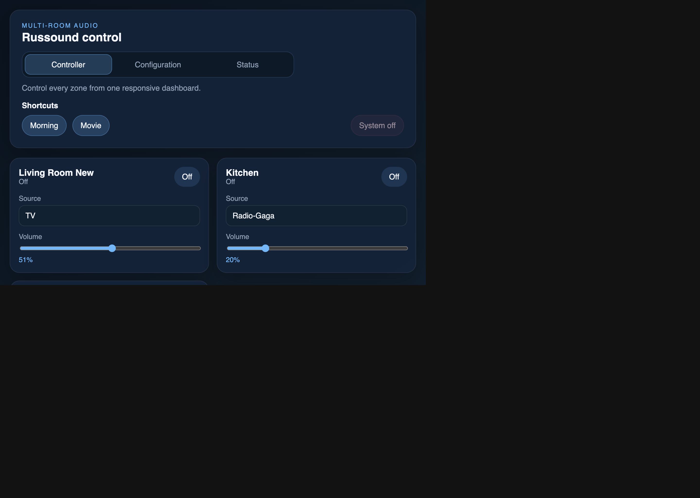
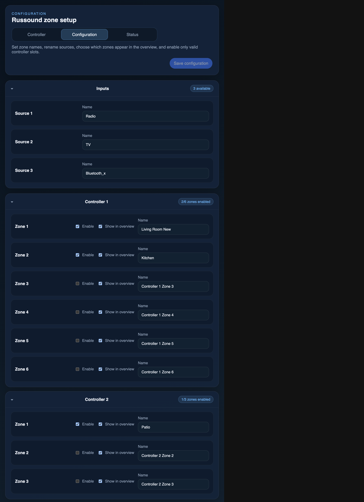
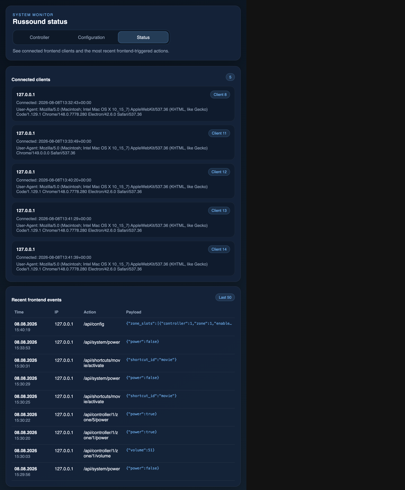

# MPDRussoundPi

MPDRussoundPi is a Python-based control stack for Russound multi-room audio systems. It combines service setup automation, runtime control scripts, and a browser UI for day-to-day operation.

The repository currently includes:

- Russound + MPD setup automation for target hosts (Ansible playbooks).
- Runtime scripts for audio setup and MPD orchestration.
- A Flask-based web control server with cross-site request protection and live synchronization.
- A controller dashboard with flip-card advanced sound controls and a visible hardware warning banner.
- A configuration editor for zones and sources.
- A status monitor for connected clients and recent frontend actions.

## UI Demonstration

### Controller Dashboard



### Configuration Editor



### Status Monitor



## Key Features

- Multi-zone Russound control (power, source, volume).
- Physical zone addressing via controller/zone mapping.
- Advanced sound controls for bass, treble, balance, and loudness.
- A prominent hardware connectivity warning banner when the backend cannot reach Russound hardware.
- Global system power-off action.
- Shortcut presets targeting multiple zones.
- Config-driven UI visibility and naming.
- Source renaming support in the web configuration editor.
- Live UI updates using Server-Sent Events (SSE).
- Cross-site request protection for state-changing `/api/*` requests (no token needed).

## Repository Structure

- `web/`: Python web server, controller logic, JSON config/state, and frontend assets.
- `tests/`: unit tests for controller logic, backend abstraction, server routing, and zone model.
- `ansible/`: provisioning and setup playbooks/tasks for deployment targets.
- `mpdrussoundpi/`: legacy/runtime Russound and MPD setup/control scripts.
- `AI_USAGE_DISCLAIMER.md`: policy statement on AI-assisted development.

## Architecture Overview

### Backend

- `web/russound_server.py`
  - Flask HTTP server.
  - Serves UI pages and static assets.
  - Exposes `/api/*` endpoints and `/api/events` SSE stream.
  - Rejects cross-site and non-JSON state-changing API requests.
- `web/russound_controller.py`
  - Domain/state orchestration.
  - Config loading and persistence.
  - Zone and shortcut mutation logic.
  - View payload building for frontend.
- `web/russound_backend.py`
  - Russound hardware adapter/wrapper.
  - Reads zone state and applies power/source/volume commands.

### Frontend

- `web/static/index.html` + `web/static/app.js`
  - Main control dashboard with the flip-card advanced audio controls and backend warning banner.
- `web/static/config.html` + `web/static/config.js`
  - Configuration editor for zones and input names.
- `web/static/status.html` + `web/static/status.js`
  - Runtime status page for clients/events.
- `web/static/styles.css`
  - Shared visual styling across all pages.

### Planned MPD web integration

See the [MPD web integration architecture](docs/mpd-web-integration-architecture.md)
for deployment alternatives, the recommended Pi-local playback agent, live
status/metadata contracts, source providers, volume controls and hardware-driven
automation. Solution D (Pi-local HTTP agent) has been selected; the
[stepwise implementation plan](docs/mpd-web-integration-implementation-plan.md)
tracks work packages and open decisions. The web application currently provides an optional, read-only MPD playback
dashboard; it does not expose playback controls. S02's collector, S03's
authenticated [read-only HTTP agent](docs/mpd-backend-api.md), the S04
production identity migration, and the S05/S06 Pi-to-Docker status path are
implemented and deployed. The dashboard reports each output's live playback
state and available now-playing metadata. S07 manual playback and calibration
gain controls are implemented/tested locally as an
[opt-in extension](docs/mpd-playback-operations-api.md) and enabled on production.
S07 is done and production-verified by the user on 2026-10-17. Source selection
and hardware-driven playback policy remain future work.
See the [deployment record](docs/playback-agent-deployment.md).

## Requirements

- macOS/Linux environment.
- Python 3.11+ recommended.
- Virtual environment support (`venv`).
- Access to Russound gateway/network where applicable.

## Quick Start (Local Development)

1. Clone the repository.
2. Create and activate a virtual environment.
3. Install dependencies.
4. Start the web server.

Example:

```bash
git clone <your-fork-or-origin-url>
cd MPDRussoundPi
python3 -m venv .venv
source .venv/bin/activate
pip install russound flask
python web/russound_server.py --config web/russound_config.json --state web/russound_state.json --port 8000
```

Then open:

- `http://127.0.0.1:8000/` (Controller)
- `http://127.0.0.1:8000/config` (Configuration)
- `http://127.0.0.1:8000/status` (Status)

## Configuration

The web server expects a JSON config file (for example `web/russound_config.json`).

Primary sections:

- `controllers`: hardware controllers with `id` and `zone_count`.
- `zones` (optional): user-facing zone definitions with `name`, `controller`, `zone`, and optional `visible`.
- `inputs`: available source list with numeric `id` and display `name`.
- `shortcuts` (optional): preset actions with `id`, `name`, `zone_addresses`, and optional `source`.

In `web/config_example.json`, `zones` and `shortcuts` are included as examples and can be omitted when not needed.

Use `web/config_example.json` as the base template for new environments.

## API Summary

The complete API reference is documented in `web/API.md`.

Common endpoints:

- `GET /api/state`
- `GET /api/config`
- `GET /api/status`
- `GET /api/events` (SSE)
- `GET /api/playback` (optional, read-only MPD inventory)
- `GET /api/playback/health` (optional MPD agent health)
- `POST /api/system/power`
- `POST /api/source`
- `POST /api/shortcuts/{shortcutId}/activate`
- `POST /api/controller/{controllerId}/zone/{zoneNumber}/power`
- `POST /api/controller/{controllerId}/zone/{zoneNumber}/source`
- `POST /api/controller/{controllerId}/zone/{zoneNumber}/volume`
- `POST /api/controller/{controllerId}/zone/{zoneNumber}/bass`
- `POST /api/controller/{controllerId}/zone/{zoneNumber}/treble`
- `POST /api/controller/{controllerId}/zone/{zoneNumber}/loudness`
- `POST /api/controller/{controllerId}/zone/{zoneNumber}/balance`

## Testing

Run the test suite with:

```bash
python3 -m unittest discover -s tests -p 'test_*.py' -q
```

Or run focused modules:

```bash
python -m unittest tests.test_zone tests.test_russound_backend tests.test_russound_controller tests.test_russound_server -q
```

See [the module-by-module coverage review](docs/test-coverage.md) for requirements, test links, and known blind spots.

## Docker

> **⚠️ Untested.** The container setup, the ser2net gateway container, and the `deploy-russound-docker.yml` playbook have not yet been run against real hardware. The images have never been built and serial device passthrough is unverified. Treat this as a starting point and validate before relying on it.

Each part runs in its own container:

| Image | Dockerfile | Purpose |
| --- | --- | --- |
| `mpdrussoundpi-web` | `Dockerfile` | Web application |
| `mpdrussoundpi-ser2net` | `Dockerfile.ser2net` | Serial gateway (RS-232 to TCP) |
| `mpdrussoundpi-dummy` | `Dockerfile.dummy` | Hardware-free [dummy backend](tool/dummy_backend/README.md) |

Two stacks combine them: `docker-compose.yml` runs the web application with the ser2net gateway (hardware), `docker-compose.dummy.yml` runs it with the dummy backend (no hardware).

```bash
docker compose up -d
```

The UI is then available on `http://<host>:8000/`. With no valid configuration,
the browser opens setup. Set the TCP gateway to `russound-ser2net`, port `6666`,
select the installed controllers and zone counts, and enable/name the connected
zones and sources. An existing valid config is retained.

### First-run setup and recovery

The web image can start with empty config/data volumes; no template file is required.
For example, using an image built from this checkout:

```bash
docker build -t russound-web:local .
docker run -d --name russound-web --restart unless-stopped \
  -p 8000:8000 \
  -v russound-config:/config \
  -v russound-data:/data \
  -v russound-logs:/logs \
  russound-web:local
```

Open `http://<host>:8000/` and configure the backend and hardware layout. The
web-only example requires an existing TCP gateway reachable from the container,
or a passed-through serial device. `127.0.0.1` refers to the container itself;
use the gateway's LAN address or its Compose service name, not the Docker host's
loopback address. Serial-device access requires device passthrough and group permissions.

- Missing, malformed, or structurally invalid configuration enters setup instead of crashing the web server.
- Setup validates backend settings, controller ids/counts, zone addresses, and sources before saving.
- Saving does not contact hardware; an offline gateway does not prevent configuration.
- The collapsible Shortcuts editor adds, renames, and removes shortcuts, with a source menu and zone checkboxes. Shortcut targets and sources must remain enabled before saving.
- Backend connectivity is shown separately and checked by the background watcher.
- Endpoint or protocol-audit-log changes reconnect without restarting the container. Names, shortcuts, controller scope, and poll-interval edits retain the existing connection and health.
- Replacing an invalid file preserves its original bytes in a sibling `russound_config.json.invalid-*.bak` file. Existing valid files are never replaced automatically.
- Config/state are written atomically within their respective directories. Both must be writable by the container user (UID `10001` by default). Named volumes avoid most first-run bind-mount ownership problems; pre-existing volumes may still need ownership correction.
- Configuration/state write errors are reported in the editor. For non-Docker runs, supply a writable `--config` path (or `RUSSOUND_CONFIG`).
- The HTTP healthcheck remains healthy in setup mode; it measures web availability, not hardware readiness.

There is no authentication. Keep the web port on a trusted LAN or protect it with
an authenticated reverse proxy; the setup page can change the backend destination.

### Serial gateway container (ser2net)

The `russound-ser2net` container bridges the USB serial cable to TCP, so no gateway is needed on the host. The web container connects to it on `russound-ser2net:6666` over the compose network.

The USB device is changeable without rebuilding the image:

```bash
RUSSOUND_SERIAL_DEVICE=/dev/ttyUSB1 docker compose up -d
```

The same variable also controls the `devices:` passthrough, so the device is mapped into the container at the same path.

Set `RUSSOUND_SERIAL_GID` to the group owning the device on the host (`stat -c '%g' /dev/ttyUSB0`, usually `dialout`) so the non-root container user may open it.

To use a ser2net instance on the host or another machine instead, point the web container elsewhere and skip the gateway service:

```bash
RUSSOUND_BACKEND_HOST=host.docker.internal docker compose up -d --no-deps russound-web
```

### Dummy backend container (no hardware)

`docker-compose.dummy.yml` starts the dummy backend together with the web container, which is pointed at `russound-dummy:6666`:

```bash
docker compose -f docker-compose.dummy.yml up -d
```

The curses TUI runs inside a `tmux` session in the container and can be attached to at any time:

On first run, configure the controller/zone/source layout in the web setup page.
The dummy stack overrides the TCP backend to `russound-dummy:6666`; the editor
shows these environment overrides explicitly.

```bash
docker exec -it russound-dummy tmux attach -t dummy
```

Detach again with `Ctrl-b d`; pressing `Q` in the TUI quits the backend and stops the container. `S` saves the state to `docker/dummy-data/dummy_state.json`, which is seeded from `tool/dummy_backend/example_state.json` on first start. Set `RUSSOUND_DUMMY_TUI=false` to run the TCP server only.

### Volumes

Config, data, and log mounts must be **directories**. Config and state are written atomically through a temporary file in the same directory. They belong to the web container.

- `/config`: holds `russound_config.json` (writable so the configuration editor can save).
- `/data`: holds `russound_state.json` and optional protocol audit logs.
- `/logs`: holds application logs and optional protocol audit logs when configured there.

### Endpoint configuration

Host and port are configurable through environment variables, which take precedence over the `backend` block of the config file.
Unset or empty overrides use the saved configuration. The image does not force a
backend port; the application defaults to `6666` when a port is not configured.
Remove an explicit override to let browser edits take effect for that field.

| Variable | Purpose | Default |
| --- | --- | --- |
| `RUSSOUND_WEB_HOST` | Web server bind address | `0.0.0.0` |
| `RUSSOUND_WEB_PORT` | Web server port | `8000` |
| `RUSSOUND_BACKEND_HOST` | Russound/ser2net gateway host override | saved config; otherwise `127.0.0.1` |
| `RUSSOUND_BACKEND_PORT` | Russound/ser2net gateway port | `6666` |
| `RUSSOUND_SERIAL_DEVICE` | USB serial device path (ser2net container) | `/dev/ttyUSB0` |
| `RUSSOUND_SERIAL_OPTIONS` | Serial line settings (ser2net container) | `19200n81` |
| `RUSSOUND_SER2NET_BIND` | ser2net bind address | `0.0.0.0` |
| `RUSSOUND_SER2NET_PORT` | ser2net listening port | `6666` |
| `RUSSOUND_SERIAL_GID` | Host GID owning the serial device | `20` |
| `RUSSOUND_CONFIG` | Config file path | `/config/russound_config.json` |
| `RUSSOUND_STATE` | State file path | `/data/russound_state.json` |
| `RUSSOUND_DEBUG` | Enable debug logging | `false` |
| `RUSSOUND_WAITRESS_THREADS` | Waitress worker threads | `24` |
| `RUSSOUND_MAX_EVENT_STREAMS` | Max concurrent live-update (SSE) streams; capped at threads − 4 so page loads and API calls always have free threads | threads − 4 |
| `RUSSOUND_TCP_USER_TIMEOUT_SECONDS` | Drop client connections whose sent data stays unacknowledged this long (Linux only, `0` disables) | `30` |
| `RUSSOUND_ALLOWED_HOSTS` | Comma-separated `Host` names/IPs accepted (blocks DNS rebinding); empty accepts any | empty |
| `RUSSOUND_ALLOWED_ORIGINS` | Extra comma-separated origins allowed to send API writes, e.g. `https://music.example` | empty |
| `RUSSOUND_TRUSTED_PROXY_COUNT` | Number of reverse proxies whose `X-Forwarded-*` headers are trusted | `0` |

Every web variable has an equivalent command-line flag (`--host`, `--port`, `--config`, `--state`, `--debug`), and the flag wins when both are provided.

On Linux hosts, set `RUSSOUND_UID`/`RUSSOUND_GID` to your `id -u`/`id -g` so the container may write the bind-mounted directories.

### Raspberry Pi provisioning

`ansible/playbooks/deploy-russound-docker.yml` prepares a Pi for the container deployment: it installs Docker Engine and the Compose plugin, clones the repository, seeds `docker/config/russound_config.json`, writes a `.env` file, and starts the `docker-compose.yml` stack (web application plus ser2net gateway).

```bash
ansible-playbook -i ansible/inventory.yaml ansible/playbooks/deploy-russound-docker.yml
```

It disables the host `ser2net` and `russound-web` services when present, because the container now provides both.

Override the defaults per host or on the command line:

```bash
ansible-playbook -i ansible/inventory.yaml ansible/playbooks/deploy-russound-docker.yml \
  -e russound_serial_device=/dev/ttyUSB1 -e russound_publish_port=8080
```

The playbook detects the serial device's group and the deployment user's UID/GID, so device access and the bind mounts work without manual tuning.

## Deployment Notes

- There is no user authentication: anyone who can reach the web port can control the system. State-changing API requests are protected against cross-site request forgery (same-origin check via `Origin`/`Sec-Fetch-Site`, JSON-only bodies), see `web/API.md`.
- Set `RUSSOUND_ALLOWED_HOSTS` to the host names/IPs you use to reach the UI to block DNS-rebinding attacks.
- For non-local deployments, place the service behind a TLS-terminating reverse proxy and set `RUSSOUND_TRUSTED_PROXY_COUNT`.
- Restrict network access to trusted clients.

## AI-Assisted Development Disclosure

This repository includes AI-assisted contributions. See `AI_USAGE_DISCLAIMER.md` for details.

## License

See `LICENSE`.
