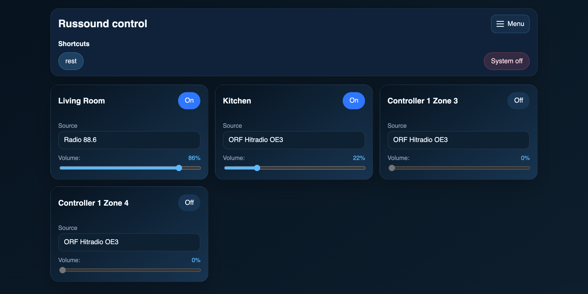
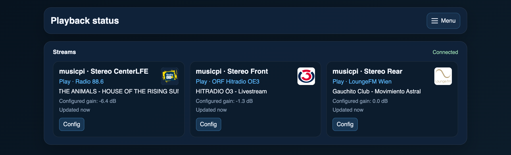
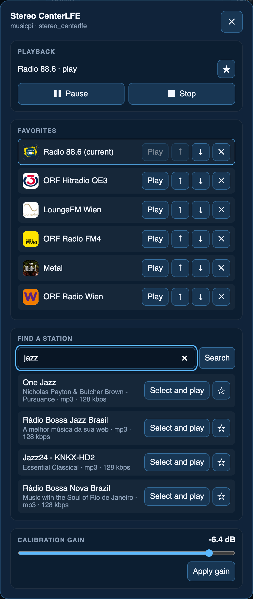
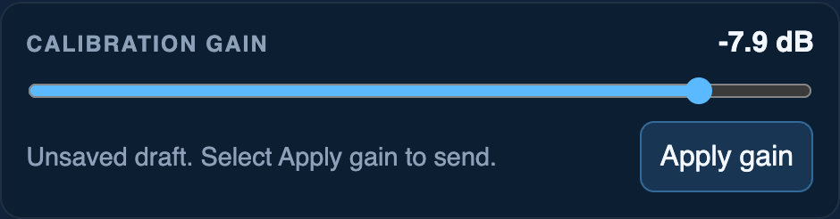
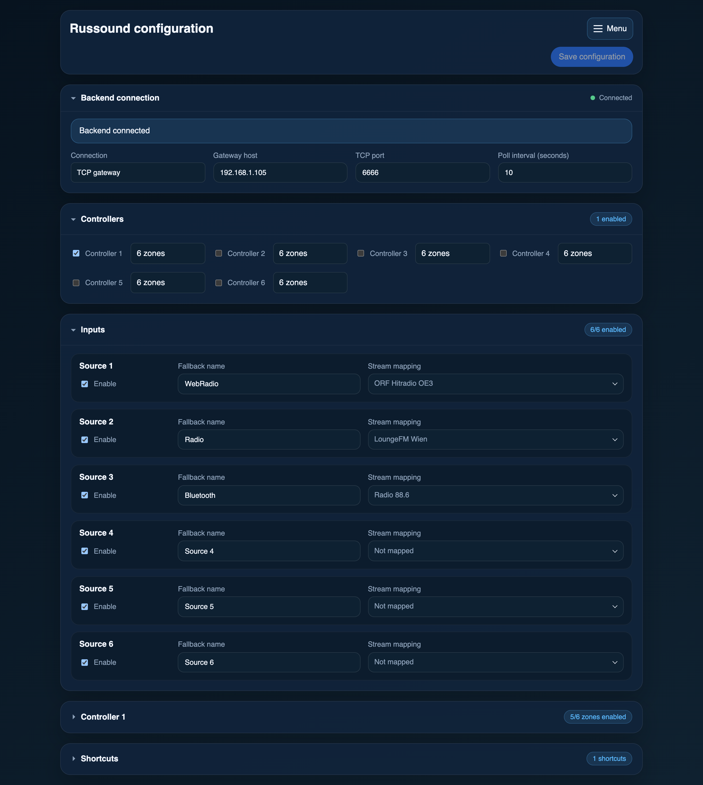
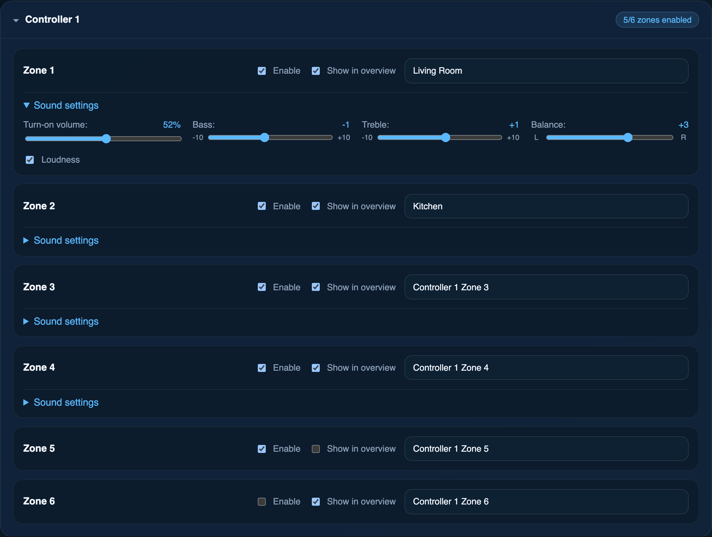
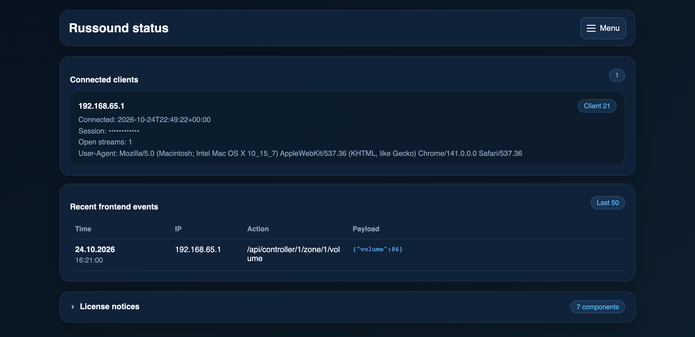

# MPDRussoundPi

MPDRussoundPi is a Python-based control stack for Russound multi-room audio systems. It combines service setup automation, runtime control scripts, and a browser UI for day-to-day operation.

The repository currently includes:

- Russound + MPD setup automation for target hosts (Ansible playbooks).
- Runtime scripts for audio setup and MPD orchestration.
- A Flask-based web control server with cross-site request protection and live synchronization.
- A controller dashboard for power, source and volume per zone, with a visible hardware warning banner.
- A configuration editor for zones and sources.
- A status monitor for connected clients and recent frontend actions.
- Per-output MPD playback, TuneIn station selection, favorites and calibration.

## UI Demonstration

### Controller Dashboard



### Playback



### Stream Configuration

Each stream card's **Config** button opens the configuration dialog for that output:

- **Playback** shows the current station and state with Play/Pause and Stop. The ★ adds or removes the current station as a favorite.
- **Favorites** is the shared station list of the playback agent. **Play** switches the output to a favorite; the arrows reorder the list and ✕ removes an entry.
- **Find a station** searches TuneIn by name or station ID (e.g. `s25744`). **Select and play** tunes the output to a result; ☆ saves it as a favorite.



**Calibration gain** is a per-output attenuation (−60 to 0 dB in 0.1 dB steps) that levels the streams so every output plays at a similar loudness on the Russound inputs. Moving the slider only edits a draft; **Apply gain** sends the new value, which the agent persists and applies immediately if the output is playing. `streamlevels.py` on the Pi measures the streams and recommends starting values (see [MPD Headless Deployment](docs/documentation/mpd-headless-deployment.md)).



### Configuration Editor



### Zone Sound Settings



### Status Monitor



## Key Features

- Multi-zone Russound control (power, source, volume).
- Physical zone addressing via controller/zone mapping.
- Per-zone sound controls for turn-on volume, bass, treble, balance, and loudness in each zone's Configuration settings.
- A prominent hardware connectivity warning banner when the backend cannot reach Russound hardware.
- Global system power-off action.
- Shortcut presets targeting multiple zones.
- Config-driven UI visibility and naming.
- Source renaming support in the web configuration editor.
- Live UI updates using Server-Sent Events (SSE).
- Cross-site request protection for state-changing `/api/*` requests (no token needed).

## Repository Structure

- `web/`: Python web server, controller logic, JSON config/state, and frontend assets.
- `tests/`: unit tests for controller logic, backend abstraction, server routing, and zone model.
- `ansible/`: provisioning and setup playbooks/tasks for deployment targets.
- `mpdrussoundpi/`: Pi audio setup, MPD backend/supervisor and playback agent.
- `docs/`: [documentation and plans](docs/README.md).
- `AI_USAGE_DISCLAIMER.md`: policy statement on AI-assisted development.

## Architecture Overview

The [software architecture](docs/documentation/software-architecture.md) describes how all parts work together at runtime. Summary:

### Backend

- `web/russound_server.py`
  - Flask HTTP server.
  - Serves UI pages and static assets.
  - Exposes `/api/*` endpoints and `/api/events` SSE stream.
  - Rejects cross-site and non-JSON state-changing API requests.
- `web/russound_controller.py`
  - Domain/state orchestration.
  - Config loading and persistence.
  - Zone and shortcut mutation logic.
  - View payload building for frontend.
- `web/russound_backend.py`
  - Russound hardware adapter/wrapper.
  - Reads zone state and applies power/source/volume commands.

### Frontend

- `web/static/index.html` + `web/static/app.js`
  - Main control dashboard (power, source, volume) with the backend warning banner.
- `web/static/config.html` + `web/static/config.js`
  - Configuration editor for the backend connection, controllers, inputs and stream mapping, zones with their sound settings, and shortcuts.
- `web/static/playback.html` + `web/static/playback.js`
  - Playback page: per-output stream status, station selection, favorites and gain.
- `web/static/status.html` + `web/static/status.js`
  - Runtime status page for clients/events.
- `web/static/styles.css`
  - Shared visual styling across all pages.

### MPD playback integration

The Pi-local agent provides live playback/metadata, optional play/pause/stop,
calibration gain, TuneIn search/selection and station favorites. The browser
talks only to the web application; MPD remains loopback-only on the Pi.
Admin configuration and runtime selections/gains/favorites are separate.
Public-only stream enforcement checks DNS/redirect destinations.
Hardware-driven automatic playback is not implemented.

Start with the [playback deployment guide](docs/documentation/playback-agent-deployment.md).
The [architecture](docs/documentation/mpd-web-integration-architecture.md) and
[implementation roadmap](docs/plans/general_done_mpd-web-integration.md) cover
design and outstanding acceptance, not installation instructions.

## Requirements

- macOS/Linux environment.
- Python 3.11+ for the Python services.
- Virtual environment support (`venv`).
- Access to Russound gateway/network where applicable.

## Quick Start (Local Development)

The default branch is `main` (stable target). For development, select `develop`
and create a feature branch before making changes; feature PRs target `develop`.
See the [development and release workflow](docs/documentation/development-workflow.md).

1. Clone the repository.
2. Create and activate a virtual environment.
3. Install dependencies.
4. Start the web server.

Example:

```bash
git clone https://github.com/itcorner/MPDRussoundPi.git
cd MPDRussoundPi
python3 -m venv .venv
source .venv/bin/activate
python -m pip install -r web/requirements.txt
python -m web.russound_server --config web/russound_config.json --state web/russound_state.json --host 127.0.0.1 --port 8000
```

Then open:

- `http://127.0.0.1:8000/` (Controller)
- `http://127.0.0.1:8000/config` (Configuration)
- `http://127.0.0.1:8000/playback` (Playback; configure an agent to populate it)
- `http://127.0.0.1:8000/status` (Status)

With no valid config, the browser opens setup. Configure the serial/TCP gateway,
controllers, zones and sources. No hardware is needed to save configuration.
For a fully hardware-free test use the [dummy layout](docs/documentation/container-deployment.md#dummy-no-hardware).
An offline hardware warning is separate from web service health.

## Choose a deployment

| Goal | Procedure |
| --- | --- |
| Run locally from source | Quick start above |
| New development container, external/managed/dummy gateway | [Container deployment guide](docs/documentation/container-deployment.md) |
| Select matching published dev images without pulling or deploying | [Image selection](docs/documentation/container-deployment.md#select-published-development-images) |
| Preview the new development layout without changing a host | [Ansible preview](docs/documentation/container-deployment.md#ansible-preview) |
| Inspect prerequisites for a new Linux target without deploying | [Explicit target preflight](docs/documentation/container-deployment.md#explicit-target-preflight) |
| Deploy or recover a prepared development target with reviewed approval | [Reviewed remote deployment](docs/documentation/container-deployment.md#reviewed-development-deployment-and-recovery) |
| Native Linux web service | [Native web deployment](#native-web-deployment) |
| Pi playback, agent, TLS and outbound enforcement | [Playback deployment](docs/documentation/playback-agent-deployment.md) |

Web deployment does not install MPD/audio. Pi playback setup is separate and
can interrupt audio. Do not run two serial gateways against the same device.

## Configuration

The web server expects a JSON config file (for example `web/russound_config.json`).

Primary sections:

- `controllers`: hardware controllers with `id` and `zone_count`.
- `zones` (optional): user-facing zone definitions with `name`, `controller`, `zone`, and optional `visible`.
- `inputs`: available source list with numeric `id` and display `name`.
- `shortcuts` (optional): preset actions with `id`, `name`, `zone_addresses`, and optional `source`.

In `web/config_example.json`, `zones` and `shortcuts` are included as examples and can be omitted when not needed.

Use `web/config_example.json` as the base template for new environments.

### Map playback outputs to Russound inputs

In the configuration editor, choose an input's **Stream mapping** for input 1
if that output is physically wired to input 1. Menu entries show the station
name followed by `[agent / output_id]`; the closed selector shows only the
station name.
The equivalent input configuration is:

```json
{
  "id": 1,
  "name": "Radio",
  "playback_output": {"agent_id": "musicpi", "output_id": "stereo_front"}
}
```

The dashboard source selector displays the selected station's name and updates
when the station changes, including while paused or stopped. `name` remains an
editable fallback; station changes never rewrite web configuration. No station
uses that fallback. Unavailable playback retains the last known station name,
marked unavailable; missing agents/outputs show the fallback and a mapping warning.
Mappings remain editable and are preserved while agents are offline. Choose
**Not mapped** to remove one. This is web display/wiring metadata only: it does
not rename physical keypads or start playback when a Russound zone changes.

## API Summary

The complete API reference is documented in `web/API.md`.

Common endpoints:

- `GET /api/rooms`
- `GET /api/config`
- `GET /api/config/state`
- `GET /api/status`
- `GET /api/events` (SSE)
- `GET /api/playback` (optional, read-only MPD inventory)
- `GET /api/playback/health` (optional MPD agent health)
- `POST /api/system/power`
- `POST /api/source`
- `POST /api/shortcuts/{shortcutId}/activate`
- `POST /api/controller/{controllerId}/zone/{zoneNumber}/power`
- `POST /api/controller/{controllerId}/zone/{zoneNumber}/source`
- `POST /api/controller/{controllerId}/zone/{zoneNumber}/volume`
- `POST /api/controller/{controllerId}/zone/{zoneNumber}/bass`
- `POST /api/controller/{controllerId}/zone/{zoneNumber}/treble`
- `POST /api/controller/{controllerId}/zone/{zoneNumber}/loudness`
- `POST /api/controller/{controllerId}/zone/{zoneNumber}/balance`

## Testing

GitHub Actions runs these suites and clean AMD64/ARM64 image smoke tests on
PRs to `develop`/`main` and pushes to those branches. See
[automated validation](docs/documentation/development-workflow.md#automated-validation).
This validates images locally on the runner; it does not publish or deploy them.

Install the test dependencies in your development environment, then run:

```bash
python -m pip install -r web/requirements.txt -r mpdrussoundpi/russound/requirements-agent.txt pyyaml
PYTHONPATH=tests python -m unittest discover -s tests -p 'test_*.py'
node --test tests/*.js
```

Or run focused modules:

```bash
python -m unittest tests.test_zone tests.test_russound_backend tests.test_russound_controller tests.test_russound_server -q
```

See [the module-by-module coverage review](docs/documentation/test-coverage.md) for requirements, test links, and known blind spots.

## Docker

The web image is built and deployed. The full USB serial-container provisioning
path still needs target acceptance; do not treat web health as proof of serial
device access or physical controller communication.

Each part runs in its own container:

| Image | Dockerfile | Purpose |
| --- | --- | --- |
| `mpdrussoundpi-web` | `Dockerfile` | Web application |
| `mpdrussoundpi-ser2net` | `Dockerfile.ser2net` | Serial gateway (RS-232 to TCP) |
| `mpdrussoundpi-dummy` | `Dockerfile.dummy` | Hardware-free [dummy backend](tool/dummy_backend/README.md) |

Use the [container deployment guide](docs/documentation/container-deployment.md)
for the new web-only development profile and its optional managed-gateway or
dummy overlay. It provides one procedure for images, data paths, startup and
verification. The Ansible preview entry point remains read-only. For prepared
same-layout Linux development deployments, the reviewed remote operator adds
explicit approval, verified local or pinned registry images, independently held
backups, controlled apply and separately approved recovery. Production and
automatic dummy-artifact deployment are not available yet.

The old `docker-compose.yml` and `docker-compose.dummy.yml` remain legacy
build-oriented stacks for existing users. They have not been silently changed
to the new layouts. Do not mix the two workflows or use either to migrate the
running Pi without a reviewed backup and explicit approval.

### First-run setup and recovery

The web image can start with empty config/data volumes; no template file is required.
See the [container guide](docs/documentation/container-deployment.md) for startup.

Open `http://<host>:8000/` and configure the backend and hardware layout. The
web-only example requires an existing TCP gateway reachable from the container,
or a passed-through serial device. `127.0.0.1` refers to the container itself;
use the gateway's LAN address or its Compose service name, not the Docker host's
loopback address. Serial-device access requires device passthrough and group permissions.

- Missing, malformed, or structurally invalid configuration enters setup instead of crashing the web server.
- Setup validates backend settings, controller ids/counts, zone addresses, and sources before saving.
- Saving does not contact hardware; an offline gateway does not prevent configuration.
- The collapsible Shortcuts editor adds, renames, and removes shortcuts, with a source menu and zone checkboxes. Shortcut targets and sources must remain enabled before saving.
- Backend connectivity is shown separately and checked by the background watcher.
- Endpoint or protocol-audit-log changes reconnect without restarting the container. Names, shortcuts, controller scope, and poll-interval edits retain the existing connection and health.
- Replacing an invalid file preserves its original bytes in a sibling `russound_config.json.invalid-*.bak` file. Existing valid files are never replaced automatically.
- Config/state are written atomically within their respective directories. Both must be writable by the container user (UID `10001` by default). Named volumes avoid most first-run bind-mount ownership problems; pre-existing volumes may still need ownership correction.
- Configuration/state write errors are reported in the editor. For non-Docker runs, supply a writable `--config` path (or `RUSSOUND_CONFIG`).
- The HTTP healthcheck remains healthy in setup mode; it measures web availability, not hardware readiness.

There is no authentication. Keep the web port on a trusted LAN or protect it with
an authenticated reverse proxy; the setup page can change the backend destination.

### Serial gateway container (ser2net)

Use the [managed gateway procedure](docs/documentation/container-deployment.md#managed-usb-gateway).
An external gateway uses the web-only profile instead; no disabled serial
service or serial-device defaults are required in that layout.

### Dummy backend container (no hardware)

Use the [dummy procedure](docs/documentation/container-deployment.md#dummy-no-hardware)
for isolated state, explicit image builds and optional TUI access. This layout
does not validate physical controller communication.

### Volumes

Config, data, and log mounts must be **directories**. Config and state are written atomically through a temporary file in the same directory. They belong to the web container.

- `/config`: holds `russound_config.json` (writable so the configuration editor can save).
- `/data`: holds `russound_state.json` and optional protocol audit logs.
- `/logs`: holds application logs and optional protocol audit logs when configured there.

### Endpoint configuration

Host and port are configurable through environment variables, which take precedence over the `backend` block of the config file.
Unset or empty overrides leave that field to the saved configuration or
application default. A nonempty valid override for either field selects TCP,
even when the saved configuration uses a serial device; removing just one
override does not restore serial mode while the other remains set. The image does not force a
backend port; the application defaults to `6666` when a port is not configured.
Remove an explicit override to let browser edits take effect for that field.

| Variable | Purpose | Default |
| --- | --- | --- |
| `RUSSOUND_WEB_HOST` | Web server bind address | `0.0.0.0` |
| `RUSSOUND_WEB_PORT` | Web server port | `8000` |
| `RUSSOUND_BACKEND_HOST` | Russound/ser2net gateway host override | saved config; otherwise `127.0.0.1` |
| `RUSSOUND_BACKEND_PORT` | Russound/ser2net gateway port | `6666` |
| `RUSSOUND_SERIAL_DEVICE` | USB serial device path (ser2net container) | `/dev/ttyUSB0` |
| `RUSSOUND_SERIAL_OPTIONS` | Serial line settings (ser2net container) | `19200n81` |
| `RUSSOUND_SER2NET_BIND` | ser2net bind address | `0.0.0.0` |
| `RUSSOUND_SER2NET_PORT` | ser2net listening port | `6666` |
| `RUSSOUND_SERIAL_GID` | Host GID owning the serial device | required in new gateway overlay; legacy default `20` |
| `RUSSOUND_CONFIG` | Config file path | `/config/russound_config.json` |
| `RUSSOUND_STATE` | State file path | `/data/russound_state.json` |
| `RUSSOUND_DEBUG` | Enable debug logging; Waitress remains the HTTP server and Flask's debugger is not enabled | image `false`; new dev profile `true`, prod layout `false` |
| `RUSSOUND_WAITRESS_THREADS` | Waitress worker threads | `24` |
| `RUSSOUND_MAX_EVENT_STREAMS` | Max concurrent live-update (SSE) streams; capped at threads − 4 so page loads and API calls always have free threads | threads − 4 |
| `RUSSOUND_TCP_USER_TIMEOUT_SECONDS` | Drop client connections whose sent data stays unacknowledged this long (Linux only, `0` disables) | `30` |
| `RUSSOUND_ALLOWED_HOSTS` | Comma-separated `Host` names/IPs accepted (blocks DNS rebinding); empty accepts any | empty |
| `RUSSOUND_ALLOWED_ORIGINS` | Extra comma-separated origins allowed to send API writes, e.g. `https://music.example` | empty |
| `RUSSOUND_TRUSTED_PROXY_COUNT` | Number of reverse proxies whose `X-Forwarded-*` headers are trusted | `0` |

Core server settings also have command-line flags (`--host`, `--port`,
`--config`, `--state`, `--debug`). Explicit host, port, config and state flags
override their environment defaults. Debug is enabled if either `--debug` or
`RUSSOUND_DEBUG` enables it; there is no CLI flag to override a true
environment value with false. `--debug` and `RUSSOUND_DEBUG` only control
diagnostic logging; they do not enable Flask's development server or
interactive debugger. Debug logs may include detailed protocol and connection
data, so protect and rotate them.
`RUSSOUND_PLAYBACK_AGENTS` is an optional JSON list of agent URLs and
token/certificate file paths; see the [playback guide](docs/documentation/playback-agent-deployment.md).

On Linux hosts, set `RUSSOUND_UID`/`RUSSOUND_GID` to your `id -u`/`id -g` so the container may write the bind-mounted directories.

### Raspberry Pi provisioning

The [new Ansible preview](docs/documentation/container-deployment.md#ansible-preview)
does not change or contact the Pi. The old
`ansible/playbooks/deploy-russound-docker.yml` remains a legacy provisioning
play, not the new workflow. It can install Docker, update a target checkout,
rewrite `.env` and stop native services. See the
[compatibility boundary](docs/documentation/container-deployment.md#existing-installations-and-legacy-entry-points)
before using it. In particular, it does not preserve the current Pi's extra
Compose override automatically.

### Native web deployment

Use this instead of Docker, not alongside another web process on port 8000:

```bash
ansible-playbook -i ansible/inventory.yaml ansible/playbooks/deploy-russound-web.yml
```

The play installs a separate web venv under `~/.local/share/russound-web/venv`,
starts native ser2net and installs `russound-web.service`. It retains configuration
in `~/.config/russound-web/russound_config.json` and runtime state in
`~/.local/state/russound-web/russound_state.json`, outside the Git checkout.
On first launch, open `http://<pi>:8000/config` to configure the gateway/layout.
Configure `russound_playback_agents` with native token/certificate paths when
adding playback integration. Changing deployment type does not automatically
copy a previous web config/state; back up and copy those files explicitly.
For an external gateway, set `russound_manage_serial_gateway=false`; the native
web play then leaves ser2net configuration and service state untouched.

## Deployment Notes

- There is no user authentication: anyone who can reach the web port can control the system. State-changing API requests are protected against cross-site request forgery (same-origin check via `Origin`/`Sec-Fetch-Site`, JSON-only bodies), see `web/API.md`.
- Set `RUSSOUND_ALLOWED_HOSTS` to the host names/IPs you use to reach the UI to block DNS-rebinding attacks.
- For non-local deployments, place the service behind a TLS-terminating reverse proxy and set `RUSSOUND_TRUSTED_PROXY_COUNT`.
- Restrict network access to trusted clients.

## AI-Assisted Development Disclosure

This repository includes AI-assisted contributions. See `AI_USAGE_DISCLAIMER.md` for details.

## License

See `LICENSE`.
