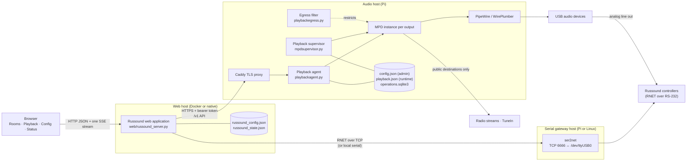
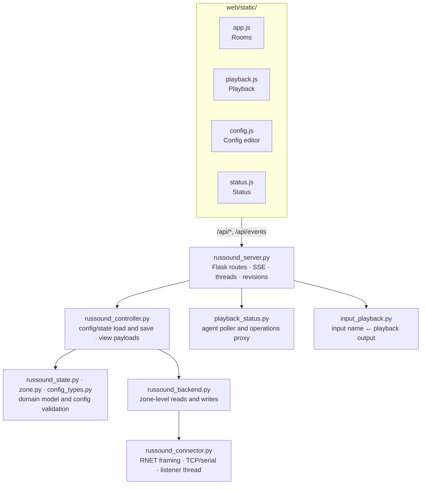
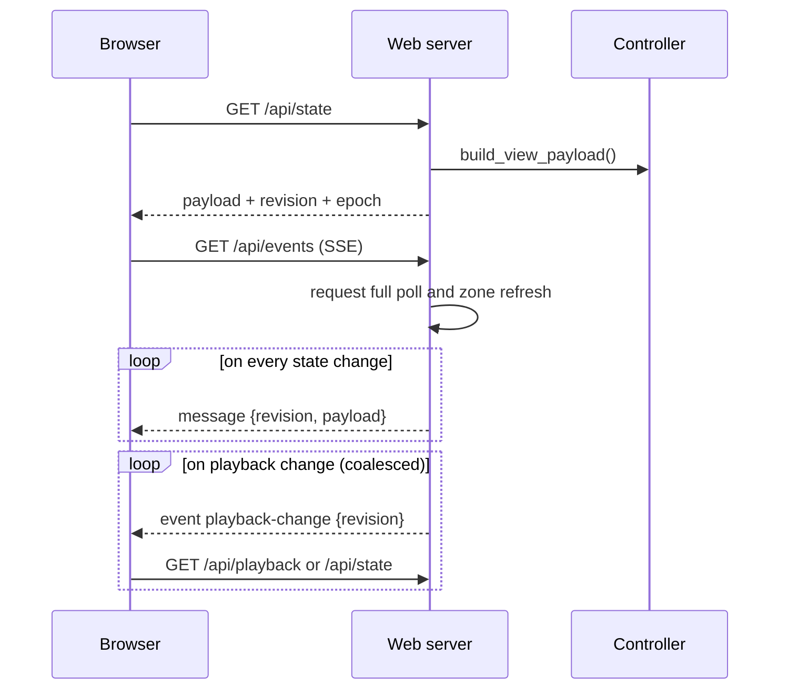
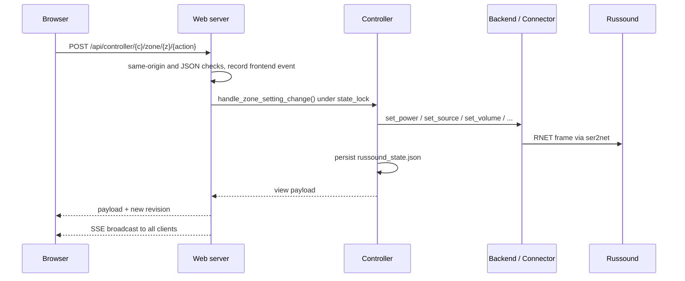
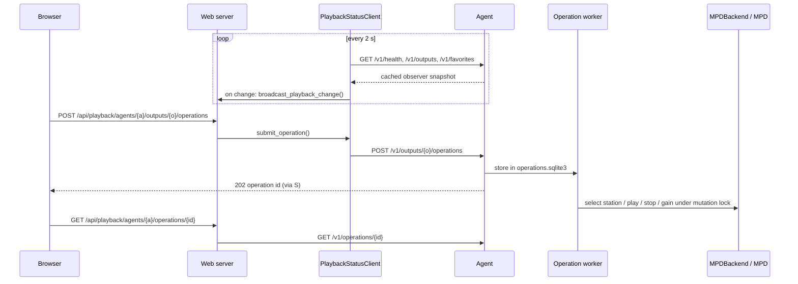
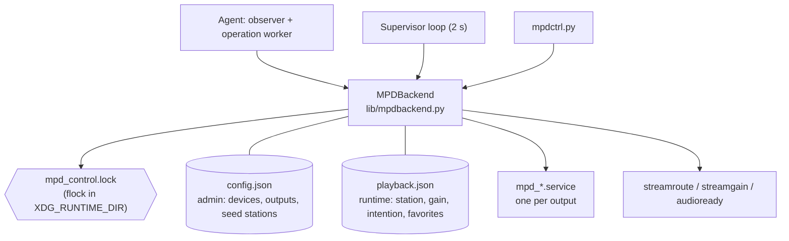

# Software architecture

This page describes how the parts of MPDRussoundPi work together at runtime:
which processes exist, what each one owns, and how commands, hardware changes
and playback status flow between them. For why the playback integration is
built this way, see the
[MPD integration architecture](./mpd-web-integration-architecture.md). For
per-module APIs, see the [module pages](./modules/).

## 1. System context

The browser only talks to the web application, which is the single gateway
to both the Russound hardware and the playback agents. MPD, PipeWire and the
playback state never leave the audio host. The analog audio path closes
the loop: each USB audio output feeds a Russound source input, and the web
configuration maps that input to its playback output.

| Part | Runs as | Code | Responsibility |
|---|---|---|---|
| Web application | `russound-web` container, or the `russound-web.service` systemd unit | [web/](../../web/) | HTTP UI and API, live events, Russound control, playback gateway |
| Serial gateway | `russound-ser2net` container or host ser2net | [mpdrussoundpi/ser2net/](../../mpdrussoundpi/ser2net/), [Dockerfile.ser2net](../../Dockerfile.ser2net) | Exposes the RS-232 adapter as TCP port 6666 |
| Playback agent | `playback-agent.service` behind `playback-agent-proxy.service` (Caddy) | [playbackagent.py](../../mpdrussoundpi/russound/playbackagent.py), `lib/playback*.py` | Versioned read and operations API for the local MPD outputs |
| Playback supervisor | `mpd_playback_supervisor.service` (systemd user unit) | [mpdsupervisor.py](../../mpdrussoundpi/russound/mpdsupervisor.py) | Starts each `mpd_<output>.service` and restores the saved playback intention |
| Audio and MPD setup | One-shot scripts run by Ansible | [audiosetup.py](../../mpdrussoundpi/russound/audiosetup.py), [mpdsetup.py](../../mpdrussoundpi/russound/mpdsetup.py) | Create PipeWire sinks per USB device and one MPD instance per output |
| Egress enforcement | `playback-egress.service` | [playbackegress.py](../../mpdrussoundpi/russound/playbackegress.py), [publicnetwork.py](../../mpdrussoundpi/russound/lib/publicnetwork.py) | MPD-only packet filter that allows public stream destinations only |
| Diagnostics | CLI on the Pi | [playbackaudit.py](../../mpdrussoundpi/russound/playbackaudit.py), [streamlevels.py](../../mpdrussoundpi/russound/streamlevels.py), [mpdctrl.py](../../mpdrussoundpi/russound/mpdctrl.py) | Endurance recording, stream loudness measurement, manual MPD control |
| Dummy backend | `russound-dummy` container | [tool/dummy_backend/](../../tool/dummy_backend/) | RNET simulator with keypad TUI for hardware-free testing |
| Capture tool | CLI | [tool/russound_capture.py](../../tool/russound_capture.py) | Decodes RNET traffic from serial, TCP or hex dumps |
| Provisioning | Ansible | [ansible/](../../ansible/) | Sets up the Pi, deploys the agent, proxy, egress and native web service |

## 2. Web application

### 2.1 Layers

| Module | Role |
|---|---|
| [russound_server.py](../../web/russound_server.py) | Owns the process: Flask routes served by Waitress, the SSE client registry, the background threads, the state revision counter and the cross-site request checks. All hardware-touching handlers run under one `state_lock`. |
| [russound_controller.py](../../web/russound_controller.py) | Application logic: loads and saves `russound_config.json` and `russound_state.json`, applies zone and shortcut changes through the backend, and builds the view payload that every page consumes. Also tracks hardware health. |
| [russound_state.py](../../web/russound_state.py), [zone.py](../../web/zone.py) | In-memory model of zones, inputs and shortcuts, with conversion to and from the persisted payload. |
| [config_types.py](../../web/config_types.py) | Typed configuration, validation and environment overrides (backend endpoint, poll interval, audit log). |
| [russound_backend.py](../../web/russound_backend.py) | Translates zone operations into connector calls and reads complete zone state, including the extended sound parameters. |
| [russound_connector.py](../../web/russound_connector.py) | RNET protocol: frame encoding and checksums, the TCP or serial transport, request/response matching, and a listener thread that decodes unsolicited keypad frames. Optional protocol audit log. |
| [playback_status.py](../../web/playback_status.py) | One client per configured agent: polls `/v1/health`, `/v1/capabilities`, `/v1/outputs` and `/v1/favorites` every 2 s, caches the snapshot and proxies operations and TuneIn search. |
| [input_playback.py](../../web/input_playback.py) | Resolves Russound input names from the station currently selected on the linked playback output. |

The frontend is plain JavaScript without a build step. Each page loads its
data through `GET /api/state`, `/api/playback`, `/api/config` or `/api/status/*`,
opens one `EventSource` on `/api/events` while visible, and closes it when hidden.
The HTTP contract is documented in [web/API.md](../../web/API.md).

### 2.2 Threads

| Thread | Started by | Work |
|---|---|---|
| Waitress request workers | `RussoundHTTPServer.run` | Serve HTTP requests. Each open SSE stream occupies one worker for up to 300 s, so the stream count is capped below the thread count. |
| `backend-change-watcher` | `_start_backend_change_watcher` | Keeps the gateway connection alive with exponential reconnect back-off (5–60 s), runs targeted zone refreshes after keypad activity, and runs a full hardware poll every `poll_interval_seconds` (2 s by default) while a browser is connected or hardware health is still unknown. |
| RNET update listener | `Russound.start_update_listener` | Reads frames the controllers send on their own, and turns them into zone updates or refresh requests. |
| `playback-status-poller` (per agent) | `PlaybackStatusClient.start` | Polls the agent and calls `broadcast_playback_change` when the snapshot changes. |

## 3. Runtime flows

### 3.1 Page load and live updates

- **State events** carry the complete view payload. Each broadcast gets a new
  `revision`, and `epoch` changes with every server start. Clients drop a
  payload only if its revision is lower than the last one they applied in the
  same epoch.
- **Playback events** are notifications only. Per client, at most one
  `playback-change` is queued at a time, and the page fetches the current
  snapshot when it receives one.
- Each SSE client has a bounded queue of 8 events. When it is full, the queue
  is drained and refilled with the latest event, so a slow client misses
  intermediate states but never blocks the server.
- Pages update existing DOM elements in place, keyed by zone or output, and
  hold back updates for controls the user is currently operating, so live
  updates do not close open selectors or interrupt sliders.

### 3.2 User command

Source selection (`/api/source`), shortcuts and system power follow the same
path. Hardware errors become HTTP 502. The sending browser applies its response
directly, and the other clients receive the SSE broadcast.

### 3.3 Hardware changes made elsewhere

Keypads and other controllers change zones without the web application's
involvement. Two mechanisms pick these changes up:

1. **Push**: the update listener decodes unsolicited RNET frames. Simple power,
   volume and source values are applied to the stored state immediately.
   Frames that only signal "something changed" add the zone to a refresh set
   and wake the watcher, which waits 0.5 s to collect related frames and then
   re-reads only those zones.
2. **Poll**: the watcher's full poll compares hardware with the stored state
   and catches anything the push path missed, including connectivity loss.

Both paths broadcast a state event only if something actually changed. Hardware
health, used for the offline banner, is part of the same payload.

### 3.4 Configuration change

`POST /api/config` validates and saves the configuration. If the gateway
endpoint or audit log changed, the server increments the backend
*generation*, drops the shared connection and lets the watcher reconnect.
Listener callbacks from the old generation are ignored. A full poll and a state
broadcast follow, so every page shows the new zones and names.

### 3.5 Playback status and operations

- The agent's **observer thread** reads MPD, route, readiness and gain state on
  its own schedule. Request handlers only return the cached snapshot and
  never call MPD directly.
- The **operation worker** runs one durable operation at a time. Station
  selection resolves TuneIn IDs or favorites on the Pi, saves the new
  intention to `playback.json` first, and then applies it.
- The browser never sends stream URLs, and the web server never holds MPD
  credentials. It forwards validated requests with the agent's bearer token
  over HTTPS.

## 4. Audio host

- `MPDBackend` is the only code that changes playback. The agent, the
  supervisor and the CLI all go through it, and every mutation holds the shared
  `mpd_control.lock`, so they cannot interfere with each other.
- `config.json` is admin-owned and never written at runtime. Everything a
  user changes goes to `playback.json`. See the
  [config split plan](../plans/mpd_done_config-split.md).
- The supervisor makes sure each output's MPD unit runs and reconciles it
  with the saved intention, retrying failed outputs with back-off up to 30 s. It
  never evaluates Russound state.
- `audiosetup.py` and `mpdsetup.py` generate the PipeWire sinks and MPD
  instances from `config.json`. They run from Ansible, not continuously.
- Station resolution ([tunein.py](../../mpdrussoundpi/russound/lib/tunein.py))
  and the MPD packet filter share
  [publicnetwork.py](../../mpdrussoundpi/russound/lib/publicnetwork.py), so the
  agent's fetches and MPD's own connections follow the same rule: public
  destinations only.

Deployment details and the audio graph are covered in
[headless MPD deployment](./mpd-headless-deployment.md) and the
[playback deployment guide](./playback-agent-deployment.md).

## 5. State ownership

| Data | Stored in | Written by | Read by |
|---|---|---|---|
| Gateway endpoint, controllers, zones, inputs, shortcuts, agent registry | `russound_config.json` (web host) | Config editor via `POST /api/config` | Web application |
| Last known zone state | `russound_state.json` (web host) | Controller after commands, push updates and polls | Web application at startup and between polls |
| Actual zone state | Russound controllers | Keypads and web commands | Web application via RNET |
| Agent token | Secret file on both hosts | Ansible | Agent, web application |
| Audio devices, outputs, seed stations | `config.json` (Pi) | Administrator, Ansible | Setup scripts, `MPDBackend` |
| Selected station, gain, intention, favorites | `playback.json` (Pi) | `MPDBackend` | Agent, supervisor |
| Pending and finished operations | `operations.sqlite3` (Pi) | Agent operation worker | Agent |
| Live playback, metadata, routes | MPD and PipeWire | MPD | Agent observer |
| Frontend event history, connected clients | Memory (web) | Web server | Status page |

Snapshots held by the web application and the agent observer are caches. They
are never the source of a desired state.

## 6. Concurrency and consistency rules

- **One hardware owner.** A single web process owns the RNET connection. All
  reads and writes that touch hardware run under `state_lock`, so commands,
  polls and push updates are serialized. Running several web workers against
  the same gateway is not supported.
- **Versioned payloads.** `revision` increases with every published state, and
  `epoch` identifies the server instance. Late or reordered responses therefore
  cannot overwrite newer state in the browser.
- **Generations.** A reconfigured gateway invalidates callbacks from the
  previous connection.
- **Bounded fan-out.** SSE queues are capped, playback events are coalesced,
  streams expire after 300 s and reconnect, and the stream count is limited by
  the Waitress thread pool.
- **One playback mutator at a time.** On the Pi, `mpd_control.lock` serializes
  agent operations, supervisor reconciliation and CLI calls. Operations are
  persisted before they run.
- **Failure isolation.** An unreachable agent marks only its own outputs as
  unavailable. An unreachable gateway shows the hardware banner, while the
  web UI and playback keep working.

## 7. Development and test setup

- `docker-compose.yml` runs `russound-ser2net` and `russound-web`, and
  `docker-compose.dummy.yml` replaces the serial gateway with the dummy backend.
  The container bind-mounts `docker/config`, `docker/data`, `docker/logs` and
  `docker/secrets`.
- Python tests in [tests/](../../tests/) cover the connector, backend,
  controller, server routes, the playback client and the Pi libraries. The
  JavaScript tests (`node --test tests/*.js`) cover the page rendering logic.
  See [test coverage](./test-coverage.md).
