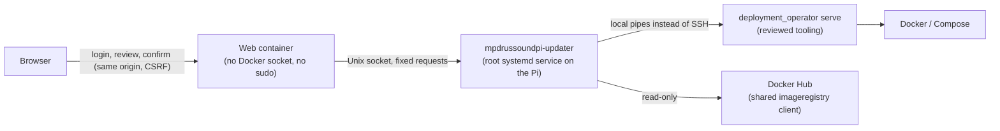

# User-triggered Docker image updates

Status: **new, planned** (2026-11-21). Decisions 1 to 4 were taken on
2026-11-21 (see [Decisions](#decisions-2026-11-21)); implementation has not
started. Recorded as an idea on 2026-10-31.

## Goal

An administrator updates the deployed Docker containers (web application and,
in the managed layout, the ser2net gateway) from the Status page, instead of
running the reviewed operator from a controller over SSH. The page already shows
whether a newer image is published (see the
[update status plan](./general_open_update-status-and-restarts.md#first-slice-web-image-update-check-2026-11-21));
this plan adds the **install** step: review, explicit confirmation, progress,
result, and a restore path after a failed update.

Out of scope: the native Pi playback agent and audio candidates (separate
deployment model), Pi base-system packages, restarts and reboots (the update
status plan), unattended or scheduled updates, downgrades from the page, and
layout, settings, mount, network or credential changes (they stay with the
reviewed operator).

## Decisions (2026-11-21)

1. **Authentication: one administrator password.** Stored only as a password
   hash in the deployment secrets and set during deployment. A login is needed
   only for privileged actions (this update, later restarts); rooms, playback,
   configuration reads and the Status page stay open as today. Session cookie
   (`HttpOnly`, `SameSite=Strict`, short idle timeout), CSRF protection on every
   privileged request, rate-limited login, audit records naming the action, time
   and client.
2. **Executor: an updater service on the Pi.** A small root systemd service runs
   the existing reviewed deployment tooling (`/opt/mpdrussoundpi-deploy`)
   locally. The web container reaches it only through a Unix socket with a fixed
   request vocabulary. The web container never gets the Docker socket, `sudo` or
   a shell.
3. **Backup custody: on the Pi, clearly labeled.** The verified backup and the
   exported old images stay in the existing private recovery storage on the Pi.
   The page states that this is not disaster recovery (same storage as the
   running system). The SSH operator with its off-host backup remains the path
   for changes that need it.
4. **Failure: offer a one-click restore, never roll back automatically.** A
   failed update stops and reports. The page then offers **Restore previous
   version**, which runs the existing recovery with the on-Pi backup after its
   own confirmation. This matches the operator, which has no automatic rollback.

## Design

### Components and trust boundaries

- **Web container:** authenticates the administrator, shows the review, forwards
  the confirmation and displays progress. It holds no deployment privileges; a
  compromised web process can only ask the updater for the documented requests,
  which still need a valid administrator confirmation of the exact review.
- **Updater:** owns the operation. It accepts `status`, `review` (resolve the
  newest candidate of the installation's channel, pinned by digest), `approve`
  (exact operation id and review digest from an authenticated administrator,
  within a bounded window), `restore` (after a failed update) and `cancel`
  (before approval). One operation at a time; a deployment already reserved by
  the SSH operator is reported as busy.
- **Reviewed tooling, reused:** the operator's controller side and its target
  side (`serve`) talk over a generic byte channel that SSH carries today. The
  updater runs both locally, connected by pipes. Reservation, image pull by
  digest, quiescence, backup and its verification, old-image export, controlled
  apply, runtime checks, recovery and evidence are unchanged code. The backup
  verification is local, which is what decision 3 accepts.
- **Approval:** the review comes from the live transaction and waits there; the
  page must confirm that exact review (operation id and digest) within the window.
  A timed-out or cancelled review ends the transaction before any interruption.
  This keeps the operator's rule that approval happens inside the live session
  and is not a reusable token.

### Self-update and progress

The update replaces the web container, so the page loses its server for a few
minutes. The page announces this before confirmation, shows the expected
interruption and then reconnects. The updater keeps a durable operation record
(accepted, reviewing, approved, applying, checking, succeeded, failed, outcome
unknown) under its private state root; the new web process reads it through the
socket and shows the result. A power loss or crash leaves the reservation and
evidence in place and is reported as **outcome unknown** with the documented
manual recovery, never as success.

### What can be selected

- Only the newest image of the installation's own channel: the `dev` tag for
  development images, the newest stable release for releases. No downgrade, no
  channel switch, no local bundles from the page.
- Web and ser2net are updated together as one candidate of the same revision,
  matching the operator's component sets for the installed layout.
- The candidate is resolved and pinned by digest when the review starts. If the
  `dev` tag moves before confirmation, the review still applies the pinned
  digest it showed.

### Mount for the socket (prerequisite)

The operator deliberately accepts only the web mounts config, data, logs and
secrets, and does not let image updates change mounts. The socket needs one more
reviewed web mount (for example `<data_dir>/updater` to `/run/mpdrussoundpi-updater`,
socket mode `0660`, group of the container's numeric user). That is a layout
change, so the operator's validation must learn this one mount and the first
rollout goes through the reviewed SSH operator. The alternative, an HTTP
endpoint on the Docker bridge with a token from the existing secrets mount,
avoids the layout change but needs a network filter and is weaker. Decide this
in stage 2.

## Stages

- [ ] **1. Administrator authentication** in the web application: password hash
  in the secrets mount (with a tool to set it), login and logout, session and CSRF
  handling, rate limit, audit log, a small login dialog on the Status page. No
  privileged action exists yet; tests cover wrong passwords, expired sessions,
  CSRF and replay.
- [ ] **2. Updater service:** systemd unit and Ansible play, socket and request
  protocol, local channel to the reviewed tooling, approval bridge with timeout,
  durable operation record, busy handling against the SSH operator, socket mount
  support in the operator's validation. Tests with the existing fixtures for
  success, failed checks, timeouts and interruption.
- [ ] **3. Status page flow:** "Update to …" for administrators in the Software
  updates section, review dialog (target revision and tags, both images, expected
  interruption, backup custody note), typed confirmation, progress, reconnection,
  result, and "Restore previous version" after a failed update.
- [ ] **4. Rollout** through the reviewed SSH operator (layout change for the
  socket mount, updater installation, administrator password).
- [ ] **5. Acceptance on the Pi:** a successful update between two development
  images; a deliberately failing candidate and restore; an interrupted update
  (power or service stop) and its documented recovery; concurrent requests; wrong
  password and CSRF rejection; and the cross-version data rehearsal below.

The [MPD web integration acceptance](./general_done_mpd-web-integration.md#acceptance-limitations-and-handover)
rehearsed same-version config/state restoration, but did not test a cross-version
or old-schema downgrade. Restore after a failed update brings back the old images
**with their own backed-up data**; include a cross-version restore rehearsal and do
not assume an earlier version can read newer persisted state.

## Related

Shares installed-image identity, channels and the registry client with the
[update status plan](./general_open_update-status-and-restarts.md); a check never
installs. The [deployment simplification plan](./general_done_simplify-deployment-configuration.md)
owns supported modes and image policy, and the
[container deployment guide](../documentation/container-deployment.md#reviewed-development-deployment-and-recovery)
describes the reviewed operator this plan reuses.
