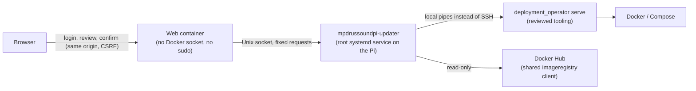

# User-triggered Docker image updates

Status: **new, planned** (2026-11-21). Decisions 1 to 7 were taken on
2026-11-21 (see [Decisions](#decisions-2026-11-21)); implementation has not
started. Recorded as an idea on 2026-10-31. The unmerged preparation of
2026-11-16 (branch `feature/deployment-update-status-planning`) was reviewed and
its consistent parts are included here (see
[Earlier preparation](#earlier-preparation-2026-11-16)).

## Goal

An administrator updates the deployed Docker containers (web application and,
in the managed layout, the ser2net gateway) from the Status page, instead of
running the reviewed operator from a controller over SSH. The page already shows
whether a newer image is published (see the
[update status plan](./general_open_update-status-and-restarts.md#first-slice-web-image-update-check-2026-11-21));
this plan adds the **install** step: review, explicit confirmation, progress,
result, and a restore path after a failed update.

Out of scope: the native Pi playback agent and audio candidates (separate
deployment model), Pi base-system packages, restarts and reboots (the update
status plan), unattended or scheduled updates, downgrades from the page, and
layout, settings, mount, network or credential changes (they stay with the
reviewed operator).

## Decisions (2026-11-21)

1. **Authentication: one administrator password.** Stored only as a password
   hash in the deployment secrets and set during deployment. A login is needed
   only for privileged actions (this update, later restarts); rooms, playback,
   configuration reads and the Status page stay open as today. Session cookie
   (`HttpOnly`, `SameSite=Strict`, short idle timeout), CSRF protection on every
   privileged request, rate-limited login, audit records naming the action, time
   and client.
2. **Executor: an updater service on the Pi.** A small root systemd service runs
   the existing reviewed deployment tooling (`/opt/mpdrussoundpi-deploy`)
   locally. The web container reaches it only through a Unix socket with a fixed
   request vocabulary. The web container never gets the Docker socket, `sudo` or
   a shell.
3. **Backup custody: on the Pi, clearly labeled.** The verified backup and the
   exported old images stay in the existing private recovery storage on the Pi.
   The page states that this is not disaster recovery (same storage as the
   running system). The SSH operator with its off-host backup remains the path
   for changes that need it.
4. **Failure: offer a one-click restore, never roll back automatically.** A
   failed update stops and reports. The page then offers **Restore previous
   version**, which runs the existing recovery with the on-Pi backup after its
   own confirmation. This matches the operator, which has no automatic rollback.
5. **Password, not a PIN.** The 2026-11-16 preparation chose a shared 4-digit
   PIN; this is superseded by a passphrase, because a leaked hash of a PIN can be
   guessed offline. One shared administrator: audit records name the session and
   action, not a person, and the session model leaves room for named accounts.
6. **Login over HTTP for now; whole-UI HTTPS later.** The 2026-11-16 preparation
   required HTTPS for the whole UI before any login. It is deferred: the first
   release runs the login on the existing LAN-only HTTP UI and documents that the
   password and session cookie can be read by anyone on that network. Whole-UI
   HTTPS (own certificate or a generated local CA, HTTP redirect-only) stays a
   planned stage; the cookie gets `Secure` as soon as HTTPS exists.
7. **"Check now" stays public.** The read-only update check (once per minute,
   public tags only) does not need a login; only installing does.

## Design

### Components and trust boundaries

- **Web container:** authenticates the administrator, shows the review, forwards
  the confirmation and displays progress. It holds no deployment privileges; a
  compromised web process can only ask the updater for the documented requests,
  which still need a valid administrator confirmation of the exact review.
- **Updater:** owns the operation. It accepts `status`, `review` (resolve the
  newest candidate of the installation's channel, pinned by digest), `approve`
  (exact operation id and review digest from an authenticated administrator,
  within a bounded window), `restore` (after a failed update) and `cancel`
  (before approval). One operation at a time; a deployment already reserved by
  the SSH operator is reported as busy.
- **Reviewed tooling, reused:** the operator's controller side and its target
  side (`serve`) talk over a generic byte channel that SSH carries today. The
  updater runs both locally, connected by pipes. Reservation, image pull by
  digest, quiescence, backup and its verification, old-image export, controlled
  apply, runtime checks, recovery and evidence are unchanged code. The backup
  verification is local, which is what decision 3 accepts.
- **Approval:** the review comes from the live transaction and waits there; the
  page must confirm that exact review (operation id and digest) within the window.
  A timed-out or cancelled review ends the transaction before any interruption.
  This keeps the operator's rule that approval happens inside the live session
  and is not a reusable token.

### Self-update and progress

The update replaces the web container, so the page loses its server for a few
minutes. The page announces this before confirmation, shows the expected
interruption and then reconnects. The updater keeps a durable operation record
(accepted, reviewing, approved, applying, checking, succeeded, failed, outcome
unknown) under its private state root; the new web process reads it through the
socket and shows the result. A power loss or crash leaves the reservation and
evidence in place and is reported as **outcome unknown** with the documented
manual recovery, never as success.

### What can be selected

- Only the newest image of the installation's own channel: the `dev` tag for
  development images, the newest stable release for releases. No downgrade, no
  channel switch, no local bundles from the page.
- Web and ser2net are updated together as one candidate of the same revision,
  matching the operator's component sets for the installed layout.
- The candidate is resolved and pinned by digest when the review starts. If the
  `dev` tag moves before confirmation, the review still applies the pinned
  digest it showed.

### Mount for the socket (prerequisite)

The operator deliberately accepts only the web mounts config, data, logs and
secrets, and does not let image updates change mounts. The socket needs one more
reviewed web mount (for example `<data_dir>/updater` to `/run/mpdrussoundpi-updater`,
socket mode `0660`, group of the container's numeric user). That is a layout
change, so the operator's validation must learn this one mount and the first
rollout goes through the reviewed SSH operator. The alternative, an HTTP
endpoint on the Docker bridge with a token from the existing secrets mount,
avoids the layout change but needs a network filter and is weaker. Decide this
in stage 2.

### Sessions, reviews and operations (from the 2026-11-16 preparation)

- **Credential handling:** memory-hard password hash with reviewed parameters in
  the secrets mount; set, rotate and reset only by a local command over SSH or
  console, never over HTTP; no default. Resetting revokes every session and
  clears the lockout.
- **Lockout:** after five failed attempts in total (across clients and workers),
  refuse further attempts for 15 minutes; failures during the lock extend it; a
  success clears the counter. The state survives restarts and handles clock
  rollback conservatively. Plus per-client throttling and generic error messages.
  A lockout is a possible denial of service; recovery is the local reset.
- **Sessions:** opaque random IDs stored hashed on the server, cookies
  `HttpOnly`, `SameSite=Strict` (and `Secure` once HTTPS exists), 15 minutes idle
  and 8 hours absolute, rotated on login, revoked on logout and reset. Disruptive
  actions (update, restore) require entering the password again within the last
  5 minutes. No password, cookie or CSRF token in logs, events, SSE or URLs.
- **CSRF:** a synchronizer token plus the existing same-origin check and JSON
  content type on every privileged request; missing browser headers never count
  as authorization. Endpoints `GET /api/admin/session`, `POST /api/admin/login`,
  `POST /api/admin/logout`, `POST /api/admin/reauthenticate` (all `no-store`).
- **Reviews:** bind actor, target, candidate digests, impact, configuration
  generation and preconditions; expire after 2 minutes; revalidated under the
  host reservation right before dispatch. A changed scope needs a new review.
  Submission carries the review digest, the explicit confirmation and an
  idempotency key (same key and payload returns the same operation, same key
  with another payload conflicts). Errors: 401/403 unauthenticated or not
  allowed, 409 expired review or busy host, 429 limits, 503 updater unavailable;
  `202` only after the updater has persisted the operation.
- **Operation states:** `accepted`, `running`, `verifying`, then `succeeded`,
  `failed` or `outcome_unknown`. The actor, review digest and pre-action
  identities are written to disk before dispatch, and the dispatch boundary is
  recorded before the tooling runs. Ambiguous dispatch is never retried
  automatically. A changed container, a returning host or a healthy page alone is
  not proof of success.
- **One maintenance gate per host:** the updater and the SSH operator share the
  deployment tooling's reservation, taken atomically inside the transaction; a
  check-then-act against `deployment_state status` would race a deployment.
- **The updater as the host broker:** build it as the narrow host-side broker
  that the [update status plan](./general_open_update-status-and-restarts.md)
  needs later for restarts and reboots: fixed operations only, configured
  targets, no addresses, unit names, paths or commands from requests, durable
  operation records owned outside the web process.

## Stages

- [ ] **1. Administrator authentication** in the web application, as described
  above: password hash in the secrets mount and a local command to set or reset
  it, login, logout and reauthentication, sessions, CSRF tokens, lockout, audit
  log, a small login dialog on the Status page, and the documented HTTP risk. No
  privileged action exists yet.
- [ ] **2. Updater service:** systemd unit and Ansible play, socket and request
  protocol, local channel to the reviewed tooling, approval bridge with timeout,
  durable operation record, busy handling against the SSH operator, socket mount
  support in the operator's validation. Tests with the existing fixtures for
  success, failed checks, timeouts and interruption.
- [ ] **3. Status page flow:** "Update to …" for administrators in the Software
  updates section, review dialog (target revision and tags, both images, expected
  interruption, backup custody note), typed confirmation, progress, reconnection,
  result, and "Restore previous version" after a failed update.
- [ ] **4. Rollout** through the reviewed SSH operator (layout change for the
  socket mount, updater installation, administrator password).
- [ ] **Later: whole-UI HTTPS** (decision 6): own certificate or a generated
  local CA with manual trust import and optional fingerprint check, HTTP
  redirect-only, trusted-proxy boundary; separate from the playback-agent TLS.
- [ ] **5. Acceptance on the Pi:** a successful update between two development
  images; a deliberately failing candidate and restore; an interrupted update
  (power or service stop) and its documented recovery; concurrent requests; wrong
  password and CSRF rejection; and the cross-version data rehearsal below.

The [MPD web integration acceptance](./general_done_mpd-web-integration.md#acceptance-limitations-and-handover)
rehearsed same-version config/state restoration, but did not test a cross-version
or old-schema downgrade. Restore after a failed update brings back the old images
**with their own backed-up data**; include a cross-version restore rehearsal and do
not assume an earlier version can read newer persisted state.

### Test catalogue (from the 2026-11-16 preparation)

- **Authentication:** anonymous, expired and revoked sessions; forged proxy
  headers; missing or wrong CSRF token or origin; replayed or expired reviews;
  the global five-attempt lockout across workers, restarts and clock rollback;
  local reset; reauthentication; no credential in any log or event.
- **Updater:** process death before and after durable acceptance, around the
  dispatch boundary and during the tooling run; no duplicate apply; explicit
  `outcome_unknown` with the reservation kept on uncertainty.
- **Races:** interleaved web updates, SSH operator deployments and recoveries;
  at most one disruptive owner per host.
- **Recovery:** accepted but not executed, failed checks after apply, and restore
  with the on-Pi backup including a cross-version data case.

## Earlier preparation (2026-11-16)

The branch `feature/deployment-update-status-planning` prepared the overview,
update status and installation plans in more breadth (native releases and host
packages as separate update adapters, restarts and reboots, a general overview
contract). Its session, review, operation, broker and test material is adopted
above. Deliberate deviations: a password instead of the PIN (decision 5), HTTPS
deferred after the first login release (decision 6), the on-Pi backup instead of
an independently verified off-host backup for web-triggered updates (decision 3),
and a public "Check now" (decision 7). Its overview contract is superseded by the
implemented `GET /api/status/overview`, and its digest-based update comparison by
the published-tag comparison of the update check. Native application releases and
host packages remain separate future adapters, as that preparation proposed;
neither is part of this plan.

## Related

Shares installed-image identity, channels and the registry client with the
[update status plan](./general_open_update-status-and-restarts.md); a check never
installs. The [deployment simplification plan](./general_done_simplify-deployment-configuration.md)
owns supported modes and image policy, and the
[container deployment guide](../documentation/container-deployment.md#reviewed-development-deployment-and-recovery)
describes the reviewed operator this plan reuses.
