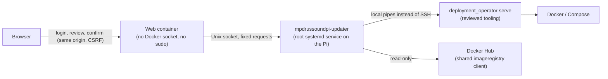

# User-triggered Docker image updates

Status: **open** (2026-11-21). Decisions 1 to 7 were taken on 2026-11-21 (see
[Decisions](#decisions-2026-11-21)). Stages 1 to 4 are implemented and rolled out
on the reference Pi (administrator login, updater service, page flow, rollout);
stage 5, the acceptance on the Pi, is in progress. Recorded as an idea on
2026-10-31. The unmerged preparation of 2026-11-16 was reviewed and its consistent
parts are included here (see [Earlier preparation](#earlier-preparation-2026-11-16)).

## Goal

An administrator updates the deployed Docker containers (web application and,
in the managed layout, the ser2net gateway) from the Status page, instead of
running the reviewed operator from a controller over SSH. The page already shows
whether a newer image is published (see the
[update status plan](./general_open_update-status-and-restarts.md#first-slice-web-image-update-check-2026-11-21));
this plan adds the **install** step: review, explicit confirmation, progress,
result, and a restore path after a failed update.

**Supported layout: a single Pi running the Docker containers.** Web-triggered
updates currently work only when the web container (and, in the managed layout,
the ser2net gateway container) run on one host together with the updater
service. Split-host layouts (web and gateway on different machines), native web
or gateway installations and the native playback agent are not supported; they
keep using the reviewed SSH operator. See
[Split-host layouts](#split-host-layouts-not-supported-yet).

Out of scope: the native Pi playback agent and audio candidates (separate
deployment model), Pi base-system packages, restarts and reboots (the update
status plan), unattended or scheduled updates, downgrades from the page, and
layout, settings, mount, network or credential changes (they stay with the
reviewed operator).

## Decisions (2026-11-21)

1. **Authentication: one administrator password.** Stored only as a password
   hash in the deployment secrets and set during deployment. A login is needed
   only for privileged actions (this update, later restarts); rooms, playback,
   configuration reads and the Status page stay open as today. Session cookie
   (`HttpOnly`, `SameSite=Strict`, short idle timeout), CSRF protection on every
   privileged request, rate-limited login, audit records naming the action, time
   and client.
2. **Executor: an updater service on the Pi.** A small root systemd service runs
   the existing reviewed deployment tooling (`/opt/mpdrussoundpi-deploy`)
   locally. The web container reaches it only through a Unix socket with a fixed
   request vocabulary. The web container never gets the Docker socket, `sudo` or
   a shell.
3. **Backup custody: on the Pi, clearly labeled.** The verified backup and the
   exported old images stay in the existing private recovery storage on the Pi.
   The page states that this is not disaster recovery (same storage as the
   running system). The SSH operator with its off-host backup remains the path
   for changes that need it.
4. **Failure: offer a one-click restore, never roll back automatically.** A
   failed update stops and reports. The page then offers **Restore previous
   version**, which runs the existing recovery with the on-Pi backup after its
   own confirmation. This matches the operator, which has no automatic rollback.
5. **Password, not a PIN.** The 2026-11-16 preparation chose a shared 4-digit
   PIN; this is superseded by a passphrase, because a leaked hash of a PIN can be
   guessed offline. One shared administrator: audit records name the session and
   action, not a person, and the session model leaves room for named accounts.
   *Amended 2026-11-21:* shorter secrets down to 4 characters (a 4-digit PIN) are
   allowed as an explicit local opt-in (`--allow-short`) with a warning; 12
   characters stay the default.
6. **Login over HTTP for now; whole-UI HTTPS later.** The 2026-11-16 preparation
   required HTTPS for the whole UI before any login. It is deferred: the first
   release runs the login on the existing LAN-only HTTP UI and documents that the
   password and session cookie can be read by anyone on that network. Whole-UI
   HTTPS (own certificate or a generated local CA, HTTP redirect-only) stays a
   planned stage; the cookie gets `Secure` as soon as HTTPS exists.
7. **"Check now" stays public.** The read-only update check (once per minute,
   public tags only) does not need a login; only installing does.

## Design

### Components and trust boundaries

- **Web container:** authenticates the administrator, shows the review, forwards
  the confirmation and displays progress. It holds no deployment privileges; a
  compromised web process can only ask the updater for the documented requests,
  which still need a valid administrator confirmation of the exact review.
- **Updater:** owns the operation. It accepts `status`, `review` (resolve the
  newest candidate of the installation's channel, pinned by digest), `approve`
  (exact operation id and review digest from an authenticated administrator,
  within a bounded window), `restore` (after a failed update) and `cancel`
  (before approval). One operation at a time; a deployment already reserved by
  the SSH operator is reported as busy.
- **Reviewed tooling, reused:** the operator's controller side and its target
  side (`serve`) talk over a generic byte channel that SSH carries today. The
  updater runs both locally, connected by pipes. Reservation, image pull by
  digest, quiescence, backup and its verification, old-image export, controlled
  apply, runtime checks, recovery and evidence are unchanged code. The backup
  verification is local, which is what decision 3 accepts.
- **Approval:** the review comes from the live transaction and waits there; the
  page must confirm that exact review (operation id and digest) within the window.
  A timed-out or cancelled review ends the transaction before any interruption.
  This keeps the operator's rule that approval happens inside the live session
  and is not a reusable token.

### Self-update and progress

The update replaces the web container, so the page loses its server for a few
minutes. The page announces this before confirmation, shows the expected
interruption and then reconnects. The updater keeps a durable operation record
(accepted, reviewing, approved, applying, checking, succeeded, failed, outcome
unknown) under its private state root; the new web process reads it through the
socket and shows the result. A power loss or crash leaves the reservation and
evidence in place and is reported as **outcome unknown** with the documented
manual recovery, never as success.

### What can be selected

- Only the newest image of the installation's own channel: the `dev` tag for
  development images, the newest stable release for releases. No downgrade, no
  channel switch, no local bundles from the page.
- Web and ser2net are updated together as one candidate of the same revision,
  matching the operator's component sets for the installed layout.
- The candidate is resolved and pinned by digest when the review starts. If the
  `dev` tag moves before confirmation, the review still applies the pinned
  digest it showed.

### Mount for the socket (prerequisite)

The socket lives in `/var/lib/mpdrussoundpi-updater/socket` on the host, mounted
read-only into the web container at `/run/mpdrussoundpi-updater` (connecting to a
socket works on a read-only mount). It is deliberately **outside** the data root:
the operator backs up the whole data root and accepts only regular files and
directories there, so a socket inside it would break every backup.

After the first deployment the operator pins the recorded Compose layout apart
from images and refuses any other change ("Recorded layout changed"). Instead of a
general layout-migration feature, the operator accepts **exactly one** addition
during an update: this read-only mount on the web service (exact source, target,
`read_only: true`, no host-path creation). The review shows it as
`layout_change`, preflight requires the socket directory to exist, and every other
layout difference, including removing the mount again, is still refused. Recovery
restores the backed-up previous layout. A first install may include the mount
directly. (Decided 2026-11-21 instead of a token-authenticated listener on the
Docker bridge, which would not have helped split hosts either.)
Since 2026-11-23 a second named addition exists, the HTTPS layout (loopback
listener, proxy settings and certificate mount as one change); see
[HTTPS for the web UI](./general_done_web-ui-https.md), stage 4.

### Split-host layouts (not supported yet)

A Unix socket, like any address on the Docker bridge, exists only on its own
machine, and the updater must run where the containers it updates run. In a split
layout (web on machine A, ser2net gateway on machine B) the web on A could update
only its own container through A's updater; B's updater would need an
authenticated network transport (for example mutual TLS, like the playback-agent
proxy) and a rule that keeps web and gateway on matching versions. That is a
possible later stage; until then split installations are updated with the SSH
operator.

## Stages

- [x] **1. Administrator authentication** (implemented 2026-11-21, not yet
  deployed: `web/admin_auth.py`, `/api/admin/*`, the Administrator panel on the
  Status page, `python -m web.admin_auth set|hash`), as described above: password hash in the secrets mount and a local command to set or reset
  it, login, logout and reauthentication, sessions, CSRF tokens, lockout, audit
  log, a small login dialog on the Status page, and the documented HTTP risk. No
  privileged action exists yet.
- [ ] **2. Updater service:** systemd unit and Ansible play, socket and request
  protocol, local channel to the reviewed tooling, approval bridge with timeout,
  durable operation record, busy handling against the SSH operator. The
  operator's narrow exception for the socket mount is implemented (2026-11-21).
  *Implemented 2026-11-21, not yet deployed:* `tool/deployment_updater.py`
  (socket server, review/approve/cancel/restore, approval bridge with a
  two-minute window, durable record, restart handling) and
  `ansible/playbooks/deploy-updater.yml`. The web endpoints and page flow are
  stage 3. Only the development channel exists, because the tooling resolves
  only `dev` images. Tests with the existing fixtures for
  success, failed checks, timeouts and interruption.
- [x] **3. Status page flow** (implemented 2026-11-21, not yet deployed:
  `web/updater_client.py`, `/api/status/update-operation`, `/api/admin/update*`,
  the "Install updates" block in the Administrator panel with typed confirmation,
  reconnection and restore; reauthentication is asked inline when the password is
  older than 5 minutes). *Revised after the first try on the Pi (2026-11-21):*
  the review card is no longer rebuilt on refresh (typing the confirmation was
  cleared every two seconds), the "Install updates" and overview "Software
  updates" sections are one "Software updates" block whose install button names
  the available version instead of a separate "Review an update", logging in
  keeps the panel open, and the overview header shows an arrow icon instead of
  the "Update available" pill so it stays on one line on phones: "Update to …" for administrators in the Software
  updates section, review dialog (target revision and tags, both images, expected
  interruption, backup custody note), typed confirmation, progress, reconnection,
  result, and "Restore previous version" after a failed update.
- [x] **4. Rollout** (2026-11-21 on the reference Pi): tooling upgraded from
  `d41264e` to `8d8079c`; new protected Compose input
  `/etc/mpdrussoundpi-deploy/russound-dev-compose.json` (the previous input plus the
  updater mount) and the controller's target spec pointed at it; updater installed
  with `deploy-updater.yml` (socket `srw-rw---- root:musicpi` in a `0750`
  directory, evidence `0700`); then the operator `--update` to `8d8079c`, whose
  review showed `layout_change` and which passed every required check. The web
  container sees the socket read-only and reports `configured: true`, phase
  `idle`, installed `8d8079c`. Playback was unaffected.
  - *Tooling upgrade* (2026-11-22): `/opt/mpdrussoundpi-deploy` upgraded from
    `8d8079c` to `6418324` with `upgrade-deployment.yml` (no failed tasks; the
    previous checkout is retained beside it as
    `/opt/mpdrussoundpi-deploy.upgrade-6418324…`). The changes were the two
    self-contained updater messages from #87 and comment-only path fixes; no
    operator, state or unit change. The idle updater was restarted to load it.
    It kept its record (`succeeded`, installed `6418324`) and recreated the
    socket with the same owner and mode. The web container reached the new
    socket without a restart. The application containers were not touched.
    This is the pattern for later updater changes: upgrade the tooling with the
    SSH play, then restart the idle updater; a web-triggered image update alone
    does not change the updater.
- [x] **Whole-UI HTTPS** (decision 6): done 2026-11-23 in its own plan,
  [HTTPS for the web UI](./general_done_web-ui-https.md). Local CA with name
  constraints, Caddy on 443, web listener on loopback, logins only over
  HTTPS.
- [ ] **5. Acceptance on the Pi:** a successful update between two development
  images; a deliberately failing candidate and restore; an interrupted update
  (power or service stop) and its documented recovery; concurrent requests; wrong
  password and CSRF rejection; and the cross-version data rehearsal below.
  Since HTTPS (2026-11-23), also: a web-triggered update and a restore over
  HTTPS, including the page's automatic reload (moved from the
  [HTTPS plan](./general_done_web-ui-https.md)).
  - [x] *Successful update* (2026-11-22): `e49ced5` → `f82d2ee` started from the
    Status page by the administrator (operation `b25f90cd`). An earlier review on
    2026-11-21 expired and was cancelled before any interruption, as designed.
    Verified independently on the Pi: updater phase `succeeded`; required checks
    apply, containers, http, backend and playback passed; the operator's committed
    pin and both running containers at `f82d2ee` with no restarts; on-Pi backup
    identity, review and result kept in the updater evidence; all three MPD
    outputs kept playing. The update check then reported `up_to_date`.
  - [x] *Failing candidate and restore* (2026-11-22, operation `63a58a79`): the
    required playback check was made to fail by stopping
    `mpdrussoundpi-playback-agent-proxy.service` before approval (MPD kept
    playing). The update `f82d2ee` → `25bc16b` from the Status page took the
    on-Pi backup, switched both containers to `25bc16b` and ended as `failed`
    ("The update failed after the services were stopped.") after the health
    deadline, with restore offered. As designed, nothing rolled back by itself:
    the operator kept its reservation, the pending record with the backup and
    the committed `f82d2ee` pin, and blocked further runs. After the proxy was
    started again, "Restore previous version" from the page (with its own
    review and confirmation) ended as `restored`: backend, containers, http
    and playback passed; both containers back on `f82d2ee`; reservation and
    pending record cleared; review, result and backup identity of both steps
    kept in the updater evidence. *Follow-up:* the page shows the failure
    message twice with slightly different wording.
  - *Page code after an update* (found 2026-11-22 with the cleanup line): the open
    page reconnected but kept running its old `status.js`, so new elements such
    as "Removed N old images" appeared only after a manual reload. Fixed: the
    page remembers the running build from `/api/status/updates` (`build`) and
    reloads itself once when it changes. It does so after an update and after a
    restore, and never loops (guarded per page and per tab). To be confirmed with
    the next update from the page.

The [MPD web integration acceptance](./general_done_mpd-web-integration.md#acceptance-limitations-and-handover)
rehearsed same-version config/state restoration, but did not test a cross-version
or old-schema downgrade. Restore after a failed update brings back the old images
**with their own backed-up data**; include a cross-version restore rehearsal and do
not assume an earlier version can read newer persisted state.

### Test catalogue (from the 2026-11-16 preparation)

- **Authentication:** anonymous, expired and revoked sessions; forged proxy
  headers; missing or wrong CSRF token or origin; replayed or expired reviews;
  the global five-attempt lockout across workers, restarts and clock rollback;
  local reset; reauthentication; no credential in any log or event.
- **Updater:** process death before and after durable acceptance, around the
  dispatch boundary and during the tooling run; no duplicate apply; explicit
  `outcome_unknown` with the reservation kept on uncertainty.
- **Races:** interleaved web updates, SSH operator deployments and recoveries;
  at most one disruptive owner per host.
- **Recovery:** accepted but not executed, failed checks after apply, and restore
  with the on-Pi backup including a cross-version data case.

## Earlier preparation (2026-11-16)

The branch `feature/deployment-update-status-planning` prepared the overview,
update status and installation plans in more breadth (native releases and host
packages as separate update adapters, restarts and reboots, a general overview
contract). Its session, review, operation, broker and test material is adopted
above. Deliberate deviations: a password instead of the PIN (decision 5), HTTPS
deferred after the first login release (decision 6), the on-Pi backup instead of
an independently verified off-host backup for web-triggered updates (decision 3),
and a public "Check now" (decision 7). Its overview contract is superseded by the
implemented `GET /api/status/overview`, and its digest-based update comparison by
the published-tag comparison of the update check. Native application releases and
host packages remain separate future adapters, as that preparation proposed;
neither is part of this plan.

## Related

Shares installed-image identity, channels and the registry client with the
[update status plan](./general_open_update-status-and-restarts.md); a check never
installs. The [deployment simplification plan](./general_done_simplify-deployment-configuration.md)
owns supported modes and image policy, and the
[container deployment guide](../documentation/container-deployment.md#reviewed-development-deployment-and-recovery)
describes the reviewed operator this plan reuses.
